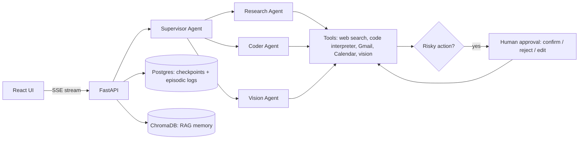

<div align="center">


<br/>

[](https://portfolio.harshraj.me)
[](https://linkedin.com/in/harsh-raj4308g)
[](https://kaggle.com/harsh7865)
[](mailto:harshraj4308g@gmail.com)

</div>

---

## About Me

```python
harsh_raj = {
    "role"      : "AI/ML Engineer · B.Tech CSE @ AKGEC (2028)",
    "focus"     : ["Agentic AI", "LangGraph / ReAct", "RAG Systems", "FastAPI backends"],
    "now"       : "AI Agentic Engineering Intern @ AxioraPeople",
    "community" : "Organizer & Mentor @ Machine Learning Centre of Excellence (MLCoE)",
    "open_source": "RAGFlow contributor (infiniflow/ragflow)",
    "available" : "Open to AI/ML & backend internship opportunities",
}
```

I build AI systems end-to-end, from architecture to deployment: autonomous multi-agent backends, real-time data platforms and RAG pipelines. Every project below is live, not just a notebook.

---

## Currently

- 🔧 Taking **AgentOS** from a working multi-agent backend to a production-grade v2
- 🌍 Contributing to open-source RAG / agent infrastructure (**RAGFlow**), working toward bug fixes and tests
- 💼 Building AI-powered hiring features and backend services as an AI Agentic Engineering Intern
- 🧮 Daily DSA practice (450+ problems solved, LeetCode contest rating 1575)

---

## Featured Projects

<table>
<tr>
<td width="50%" valign="top">

### ⚙️ AgentOS
**Multi-agent AI backend with human-in-the-loop safety**

LangGraph ReAct agent with a **Supervisor** routing to 3 specialised sub-agents (Research, Coder, Vision), three-tier memory (Postgres checkpointing, ChromaDB RAG, episodic audit logs) and **confirm / reject / edit** approval for risky tool calls. Approval flow verified end to end against a live Gmail account: a real send executed only after explicit approval.

**Stack:** `LangGraph` `FastAPI` `PostgreSQL` `ChromaDB` `Groq` `SSE`

[](https://agentos-core-ivory.vercel.app)&nbsp;[](https://github.com/Harsh28-raj/agentos-core)

</td>
<td width="50%" valign="top">

### 🛰️ SolarSentinel
**Real-time space weather intelligence platform**

Tracks **27,000+ satellites** in real time on live NASA / NOAA APIs, modelling per-satellite damage probability (0–100) via orbital mechanics and NASA SHIELDOSE-2. L1 solar-wind pipeline delivers **45-minute early warnings** for geomagnetic storms with grid heatmaps and automated G1–G5 risk alerts.

**Stack:** `FastAPI` `Python` `NASA DSCOVR` `NOAA GOES` `Skyfield` `NumPy`

[](https://solar-sentinel-v3.onrender.com)&nbsp;[](https://github.com/Harsh28-raj/solar-sentinel-v3)

</td>
</tr>
<tr>
<td width="50%" valign="top">

### 📊 DataMind AI
**Agentic conversational data analyst**

LangGraph agent that turns plain-English questions into SQL / Pandas over DuckDB's OLAP engine, then surfaces hidden data issues with **3-layer anomaly detection** (IQR, Z-Score, Isolation Forest), auto-generated Plotly charts and streamed AI summaries that explain its own reasoning.

**Stack:** `LangGraph` `FastAPI` `DuckDB` `Groq` `Streamlit`

[](https://datamind-ai-frontend.onrender.com)&nbsp;[](https://github.com/Harsh28-raj/agentic-ai-data-analyst)

</td>
<td width="50%" valign="top">

### 🤖 UNIT-V432 · Kinetic Intelligence
**Autonomous terrain navigation system**

Segmentation model on a Meta AI **DINOv2 ViT-S14** backbone with a custom decoder built from scratch, reaching **98%+ validation accuracy** on a 2GB+ dataset across 10 terrain classes. CLAHE preprocessing lifted low-visibility detection by **30%**.

**Stack:** `PyTorch` `DINOv2` `OpenCV` `Streamlit`

[](https://kinetic-intelligence-v432.streamlit.app/)&nbsp;[](https://github.com/Harsh28-raj/Kinetic-Intelligence-V432)

</td>
</tr>
<tr>
<td width="50%" valign="top">

### 🏥 AI Healthcare Platform
**RAG-powered multi-service healthcare assistant**

**7 independent FastAPI microservices**: disease prediction, drug-condition classifiers, food / medicine barcode lookup and a FAISS + Groq RAG chatbot (MediMind). Deployed on Render and consumed by a React web app and a Flutter mobile app.

**Stack:** `FastAPI` `FAISS` `LangChain` `MongoDB Atlas`

[](https://healhcare-ai.vercel.app)&nbsp;[](https://medimind-bot.streamlit.app)&nbsp;[](https://github.com/Harsh28-raj/Ai_healtcare)

</td>
<td width="50%" valign="top">

### ✍️ BlogForge
**LangGraph multi-agent content pipeline**

Research → Planning → Writing agent workflow with Tavily web search and Groq inference that turns a single topic into a structured, SEO-friendly blog post, fully automated end to end.

**Stack:** `LangGraph` `LangChain` `Groq` `Tavily`

[](https://blogforge-ai18.streamlit.app/)&nbsp;[](https://github.com/Harsh28-raj/BlogForge)

</td>
</tr>
</table>

---

## How AgentOS Works



Design choices worth noting: Postgres (not Redis) for checkpointing so long-pending approvals survive restarts without TTL risk, SSE instead of WebSockets for one-way streaming of agent events, and a max-step guard that auto-terminates runaway agent loops.

---

## Engineering Highlights

| Area | What I did | Result |
|---|---|---|
| Agent safety | Human-in-the-loop approval (confirm / reject / edit) with full audit trail in Postgres | Risky actions never run unapproved |
| Real-time systems | NASA / NOAA telemetry pipeline with orbital-mechanics damage modelling | 27,000+ satellites, 45-min early warnings |
| Computer vision | DINOv2 ViT backbone + custom decoder + CLAHE preprocessing | 98%+ val. accuracy, +30% low-visibility detection |
| ML engineering | Fixed a Random Forest data leak; built a KNN engine for 144,000 records | +63% real-world accuracy, no more memory crashes |
| MLOps | Automated 3 preprocessing pipelines, containerised deployments | 40% faster deployment, 15% faster processing |

---

## Open Source

| Project | Contribution | Status |
|---|---|---|
| [RAGFlow](https://github.com/infiniflow/ragflow) | [#20548](https://github.com/infiniflow/ragflow/pull/20548): docs update adding a provider to the tested OpenAI-API-compatible model list | ✅ Merged |

Next up: bug fixes and tests in the RAG / agent space.

---

## Experience

- **AI Agentic Engineering Intern**, AxioraPeople (Sep 2026 – Present, Remote): backend architecture, AI-powered hiring features (resume screening, AI video interviews) and containerised deployment
- **Machine Learning Engineer**, AKGEC MLCoE (Aug 2024 – Nov 2024): KNN engine for 144,000 records, Random Forest data-leak fix, pipeline automation
- **Organizer & Mentor**, AKGEC MLCoE (2025 – Present): mentoring juniors in applied ML / AI; led **CONVOLUTE'26**, a datathon with 1,344+ applicants

---

## Tech Stack

**Languages**


**Agents, LLMs & RAG**


**ML & Deep Learning**


**Backend, Data & MLOps**


**Vector Stores:** `FAISS` · `ChromaDB`

---

## Certifications & Achievements

- 🎓 Oracle Agentic AI Certified Foundations Associate · Oracle Cloud Infrastructure Foundations Associate
- 🎓 Google DeepMind AI Research Foundations (Capstone) · Anthropic AI Fluency: Framework & Foundations
- 🎓 IBM SkillsBuild: Unleashing the Power of AI Agents · CampusX: FastAPI, Advanced RAG, Agentic AI Development
- 🏆 **Amazon ML Challenge 2026**: ranked under 700 among 100,000+ registrations (72-hour business entity resolution hackathon)
- 🏆 **DeepThought CultureTech Fellowship**: ranked #1 among shortlisted candidates
- 💻 450+ DSA problems solved · LeetCode contest rating 1575

---

## GitHub Stats

<div align="center">


<br/>


</div>

---

<div align="center">

*"I don't build prototypes. I build things that ship."*

</div>
